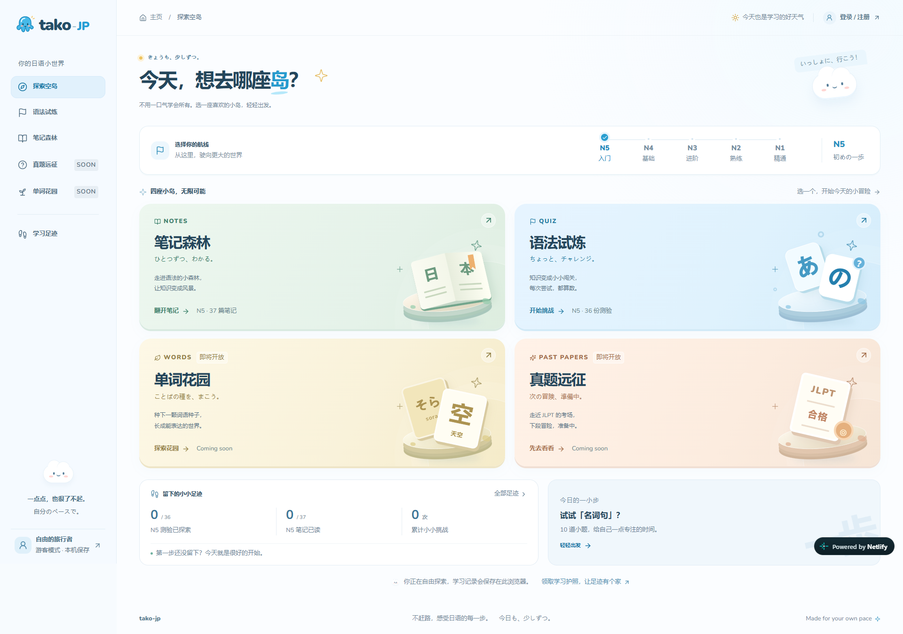

# tako-jp · 日语学习的小小世界

一个轻松、有趣的日语学习网站，也是我的日语笔记与测验资料库。以天蓝色天空和浮空岛屿为主题，把阅读笔记、语法练习和学习记录放进同一个小世界。

**线上体验：[https://tako-jp.netlify.app/](https://tako-jp.netlify.app/)**

[](https://tako-jp.netlify.app/)

## 可以做什么

- **笔记森林**：阅读美化后的 Markdown 日语笔记，支持课程搜索、目录导航和关联测验。电脑端采用紧凑目录与正文分栏，手机端独立阅读；不再手动标记已读，已有历史阅读记录保留。
- **语法试炼**：按 JLPT 等级选择测验，支持即时解析、译文与提示、上一题 / 下一题、跳题、点阵选题和草稿续答。
- **学习足迹**：查看历史成绩、最佳纪录、最近学习活动和笔记阅读记录，并导出记录备份。
- **游客与账号**：不注册也能学习，游客记录保存在当前浏览器；注册时需输入两次密码确认，登录后可合并当前浏览器的已完成记录，并将账号记录保存在云端。
- **单词花园**：开放 N5、N4，通过清音 / 浊音 / 半浊音三个标签共用的五十音目录按首音浏览（默认「あ」），支持搜索和查看全部，每页 20 词并连续编号。展示假名读音、罗马音、英文释义与例句，动词按 1／2／3 类标注。每轮随机抽背 10 词，可渐隐显示 / 隐藏读音，自评认识 / 不认识，保存战绩和待复习词。N3–N1 暂未解锁。
- **真题远征**：目前仅开放入口，显示 Coming soon，暂未提供在线练习。

网站提供 **N5–N1** 等级入口，实际可学习内容以各等级已有资料为准；没有内容的等级会明确显示待更新。

> 测验第一次选择后会展示解析并锁定答案；可以回看已答题，也可以返回补答跳过的题。提交时，留白题按未答对计分。

## 技术栈

- **前端**：Next.js App Router、React、TypeScript、Tailwind CSS、Motion
- **笔记渲染**：react-markdown、GFM、HTML 安全过滤与自定义阅读样式
- **账号存储**：Netlify Database / PostgreSQL
- **部署**：Netlify、OpenNext adapter
- **统计**：可选 Google Analytics 4，未配置时不加载统计脚本

## 仓库结构

| 目录 | 内容 |
| --- | --- |
| [web](./web/) | tako-jp 网站代码、测试及部署配置 |
| [notes/raw](./notes/raw/) | 原始 Markdown 日语笔记 |
| [quiz](./quiz/) | 测验资料；网站使用 JSON，HTML 保留给本地单独打开 |
| [raw/jlpt](./raw/jlpt/) | JLPT 真题原始资料，尚未接入网站 |

网站应用独立放在 `web` 中，不修改上层学习资料。生产构建会将所需笔记、JSON 题库和图片打包后部署。

词库位于 [web/data/vocabulary](./web/data/vocabulary/)，使用 [OpenJLPT](https://github.com/evanclan/OpenJLPT) 的 N5、N4 原版英文 JSON，基于 Jonathan Waller 的非官方 JLPT 词表、JMdict（EDRDG）和 Tatoeba。词库按 **[CC BY-SA 4.0](https://creativecommons.org/licenses/by-sa/4.0/)** 共享，原例句为 CC BY 2.0 FR，详见词库内的 [NOTICE](./web/data/vocabulary/NOTICE.md) 和 [LICENSE](./web/data/vocabulary/LICENSE)。抽背结果为自评，不代表客观测试分数。

读音与例句通过有道智云语音合成播放，喇叭和 API 仅向已登录用户开放；游客仍可浏览和抽背。需配置服务端密钥并启用语音合成服务，见下方部署说明。接口按账号限制每 15 分钟最多 60 次未缓存合成，音频缓存由数据库共享（最长 7 天，最多 2,000 条 / 32 MiB）；缓存不代表免除供应商费用或使用许可要求。

## 本次更新的 Netlify 配置

1. 保持现有应用配置：Base directory 为 `web`、构建命令 `npm run build`、发布目录 `.next`，Node.js 24。保留现有 Netlify Database，不要重建数据库或手动替换其连接串。
2. 在有道智云中为应用开通并绑定**语音合成**服务，确认日语音色权限、余额 / 赠送额度及网站播放和缓存许可；仅开通文本翻译不足以使用发音。
3. 进入 Netlify 项目的 **Project configuration → Environment variables**，新增以下服务端变量，作用域选择 **Functions**（若当前界面支持多选，也可包含 Builds），部署上下文至少选择 **Production**：

   | 变量 | 值 |
   | --- | --- |
   | `YOUDAO_APP_KEY` | 有道应用 ID |
   | `YOUDAO_APP_SECRET` | 有道应用密钥，标记为 Secret |
   | `YOUDAO_JA_VOICE` | 可选，默认 `youkejiang`；须为应用有权限使用的日语音色 |

   不要加 `NEXT_PUBLIC_` 前缀，也不要把密钥写入仓库。若预览部署也需要发音，再单独配置 Deploy Previews；否则不开放预览环境的供应商额度。
4. 推送更新后，在 **Deploys** 确认新部署成功；如果先部署后添加环境变量，需要再次触发部署。本次新增两份数据库迁移：单词抽背记录、发音限流与缓存。已启用的 Netlify Database 会在部署流程中应用 `web/netlify/database/migrations` 的增量迁移；如迁移报错，先排查部署日志，不要删除旧表或旧迁移。
5. 上线后退出登录确认没有喇叭；登录后播放一个单词读音和一个例句，并完成一轮抽背确认记录保存。未配置密钥会明确报错，游客直接请求发音接口会返回 401。有道额度和超额计费以控制台为准，应用限流不是总费用封顶。

## 本地运行

需要 **Node.js 24+**。请保留完整仓库结构，不要只下载 `web` 目录。

在仓库根目录运行：

```shell
cd web
npm install
npm run dev
```

打开 **[http://localhost:3107](http://localhost:3107)**。

本地数据库自动启动，无需额外安装。
